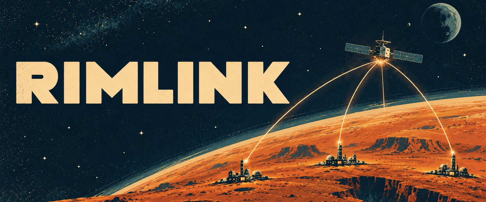
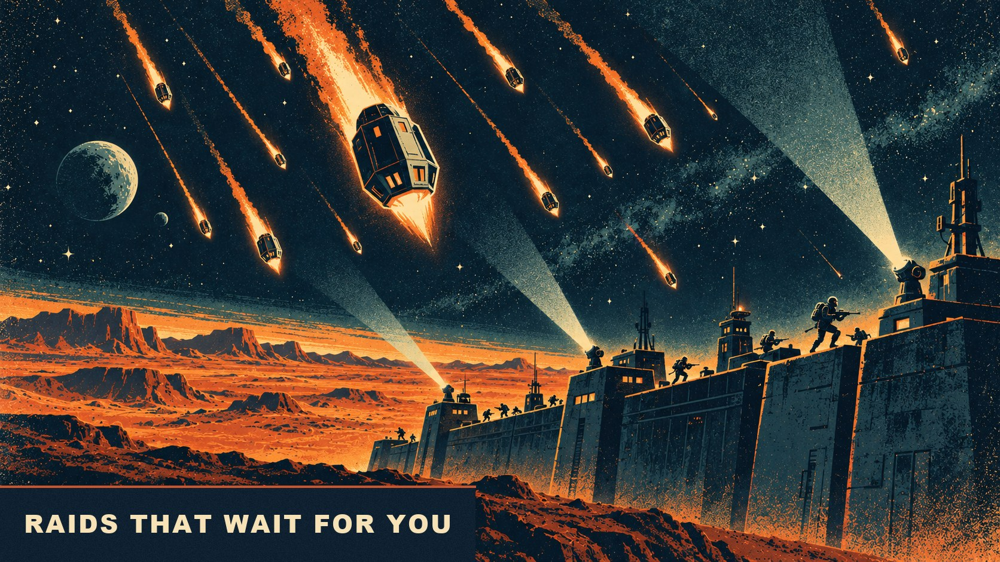

<p align="center">
  
</p>

<p align="center">
  <a href="https://github.com/Asofwar/rimlink/releases/latest"></a>
  <a href="https://github.com/Asofwar/rimlink/actions/workflows/ci.yml"></a>
  
  <a href="LICENSE"></a>
  <a href="#support"></a>
</p>

Rimlink is persistent multiplayer for RimWorld 1.7. Every player runs their own colony in their own game, on one planet
shared through a dedicated server. A colony is frozen while its owner is offline, so a group can play together without ever
being online at the same time; when two players are online, one can walk onto the other's map and play there live.

Rimlink is a clean-room project with its own protocol, server and client. It shares no code with other RimWorld multiplayer
mods and does not work with them.

## What makes it different

- **A world that stays.** The server keeps the planet, every settlement, the chat and everyone's saves. Players come and go,
  and the world is still there. Other colonies show on your world map with an online light and a wealth tier.
- **No need to be online together.** A raid waits on the server until its target next plays, then runs in the target's game
  as a normal raid. A visit loads a copy of the host's colony, with a shop the host stocks.
- **Live when you are.** When both players are online, a raid or a visit happens on the host's running map. The guest gives
  orders to their own pawns through a mirrored copy, with pings, shared pauses and speed marks.
- **An economy on escrow.** Anything a player sends away waits on the server, and nothing is duplicated or lost on a dropped
  connection: a market board, silver wallets, gifts that wait for an answer, and two-way trades with double confirmation. For
  silver you can also order a raid or another event against a colony, priced by its wealth.
- **Rules a server can hold.** New and poor colonies are protected, there is a peaceful mode, raids have loot caps and
  cooldowns, and wealth kept on the server still counts. By default dev mode is for admins, sudden jumps in wealth alert them,
  and every colony plays with the world's storyteller.
- **Built to be run.** A Docker image, a web admin panel with a public status page, named API tokens with scopes, backups,
  Prometheus metrics and a Discord bot with a two-way chat bridge. Players with the wrong mods get a list and a **Fix and
  restart** button.

<table>
  <tr>
    <td></td>
    <td></td>
  </tr>
  <tr>
    <td></td>
    <td></td>
  </tr>
</table>

## Quick start for players

You need RimWorld 1.7, the [Harmony](https://steamcommunity.com/sharedfiles/filedetails/?id=2009463077) mod and a Rimlink
server to join. Rimlink has no central server: ask your admin for an address, or run your own.

1. Subscribe to [Rimlink on the Steam Workshop](https://steamcommunity.com/sharedfiles/filedetails/?id=3830084263). Or download
   `rimlink-client-<version>.zip` from the [latest release](https://github.com/Asofwar/rimlink/releases/latest) and unpack it
   into `RimWorld/Mods/`, so that `RimWorld/Mods/Rimlink/About/About.xml` exists.
2. Enable **Harmony** and **Rimlink** in the mod list (Harmony first) and restart the game.
3. Open **Multiplayer** → **Add server** in the main menu and enter the address and port (default `25560`).
4. Compare the certificate fingerprint with the one your admin gave you, then confirm it. Steam logs you in by itself; some
   servers use a login and password.
5. If your mods differ from the server's, **Fix and restart** sorts them out and logs you back in.
6. Pick a free tile on the server's planet and start your colony.

The [player guide](docs/player-guide.md) covers trading, raids, live sessions and what to do when something goes wrong.

## Quick start for server admins

The server is one .NET 10 process with one open TCP port, and it runs on Windows or Linux. With Docker:

```bash
mkdir -p rimlink/data && cd rimlink
curl -O https://raw.githubusercontent.com/Asofwar/rimlink/main/deploy/docker-compose.yml
printf 'RIMLINK_API_TOKEN=%s\nSTEAM_WEB_API_KEY=%s\nADMIN_STEAM_ID=%s\n' "$(openssl rand -hex 32)" "<key>" "<your steamid64>" > .env
docker compose up -d
```

Without Docker, take `rimlink-server-<version>-<runtime>.zip` from the
[latest release](https://github.com/Asofwar/rimlink/releases/latest). Then:

1. Log in from the game with the admin account and create the planet. Nobody else can log in until it exists.
2. Set the modpack from your own game or with `rimlink-tools modpack import`.
3. Open the web panel at `https://<host>:25560/admin/` with your API token. The public page at `https://<host>:25560/` shows
   players the address, the certificate fingerprint and the modpack.

Steam logins need a free Steam Web API key; without one, turn on password accounts. The
[server setup guide](docs/server-setup.md) has all of this in detail, plus TLS, economy and raid settings, backups,
updating, monitoring and the Discord bot.

## Status

Current version: **0.6.0**, see the [release notes](https://github.com/Asofwar/rimlink/releases/latest). Rimlink is young, so
back up your server's data before you update it. Every player on a server plays the server's mod list, and a host's
colony can only be visited by players who have the host's mods.

## Development

| Path | Purpose |
|---|---|
| `src/Rimlink.Protocol` | gRPC/protobuf contracts shared by server and client |
| `src/Rimlink.Server` | ASP.NET Core dedicated server: gRPC game API, REST admin API, SQLite, web panel |
| `src/Rimlink.Client.Core` | Game-independent client: connection, state, outbox, save transfer, live client |
| `src/Rimlink.Client` | The RimWorld 1.7 mod (Harmony); built against the game, not in the solution |
| `src/Rimlink.Tools` | Admin CLI (`rimlink-tools`) |
| `src/Rimlink.Discord` | Discord bot |
| `tools/Rimlink.BridgeTools` | Dev-only companion that drives the game for two-player test runs |
| `tests/` | Server, client-core and bridge-tool tests |
| `mod/` | Mod metadata, defs, languages |
| `scripts/`, `deploy/` | Build and release scripts; Dockerfiles, compose files, sample configuration |

```bash
dotnet build Rimlink.sln
dotnet test Rimlink.sln
docker build -f deploy/Dockerfile -t rimlink-server .
```

The client mod needs RimWorld 1.7 and the Harmony mod (PowerShell):

```powershell
.\scripts\Build-ClientMod.ps1 -RimWorldDir 'C:\...\RimWorld' -InstallTo 'C:\...\RimWorld\Mods'
.\scripts\Package-Release.ps1   # dist/rimlink-client-<ver>.zip, dist/rimlink-server-<ver>-<rid>.zip
```

[AGENTS.md](AGENTS.md) is the full guide to the code and the rules of the project; design documents are in
[docs/superpowers/specs](docs/superpowers/specs).

## Support

Rimlink is free. If you enjoy it and want to buy me a coffee, you can send Gram (TON) to my Telegram wallet:

<p></p>

`UQAdvK_4JyPGKpuD3Z27LkRZG7qmQ-03oWtUROMYNTz-Sx23` ·
[send from a TON wallet](https://app.tonkeeper.com/transfer/UQAdvK_4JyPGKpuD3Z27LkRZG7qmQ-03oWtUROMYNTz-Sx23?text=Rimlink)
(TON network only: a transfer from another network is lost)

## License

MIT, see [LICENSE](LICENSE). Rimlink is an independent fan project, not affiliated with or endorsed by Ludeon Studios. You
need your own copy of RimWorld.
