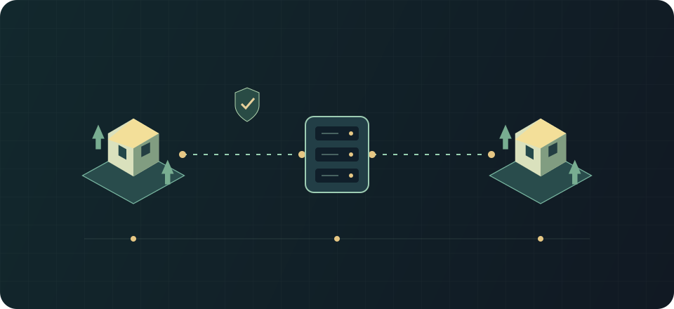

# Connecting and signing in

Applies to: Rimlink 0.8.1 · RimWorld 1.7 · protocol 1.

Two colonies connect to the server over a secure connection.

## Usage {#usage}

Add the host and port in **Multiplayer** (default 25560). Obtain the address from the administrator; the browser panel URL and game endpoint need not match. A server-wide password, if configured, is additional to personal authentication.

Steam login uses a Steam ticket. Password login is available only when enabled by the server; credentials belong to that server. A new certificate is remembered after trust is granted. If its pin changes, confirm the certificate replacement with the administrator first.

After login the server loads your saved colony, offers a new colony, or shows modpack differences. Resolve the listed differences and reconnect.

## Limits and safety {#limits}

Do not disable TLS to work around certificate errors. Never send personal passwords in chat. For a temporary Steam refusal, let authentication retry rather than creating many accounts.

## See also {#related}

- [Server modpacks](./modpacks.md)
- [TLS, authentication and permissions](../admins/security-auth.md)
- [Player troubleshooting](./troubleshooting.md)
