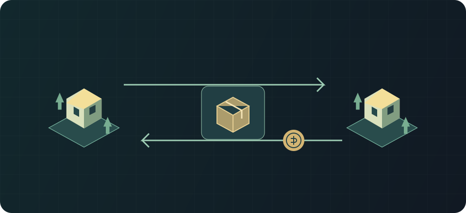

# Wallet, mail and market

Applies to: Rimlink 0.9.2 · RimWorld 1.7 · protocol 1.

Exchanges use server escrow; deliveries arrive through the mailbox.

## Usage {#usage}

<ol class="flow-diagram" aria-label="Process diagram"><li><strong>Intent</strong>Goods/pawns/wallet and original request ID.</li><li><strong>Snapshot</strong>Journal and exact home-map acceptance.</li><li><strong>Escrow</strong>Server retains until settlement or cancellation.</li><li><strong>Mailbox</strong>Receive → save → acknowledge.</li></ol>

Normal operations require a comms console and powered trade beacons; goods are selected from their served area. The wallet is a server silver balance, not a physical stack. Depositing moves silver into that balance; withdrawal arrives through a server parcel.

List items or a pawn as an ordinary lot, set a price and review its contents. The buyer pays from the wallet, goods enter delivery and the seller receives proceeds minus any fee. Unsold lots expire after 30 days by default.

Check mail after a transaction or disconnect. The server holds outgoing goods in escrow until settlement and returns them through parcels.

## How do I deposit silver, buy and receive goods? {#wallet-market}

Select a colonist → right-click the **comms console** → **Rimlink**. Eligible items come from powered orbital trade beacon areas. A wallet is a server balance; silver stacks on the floor do not enter it automatically.

1. Place silver under a beacon. In **Wallet**, deposit it and wait for the save/transfer operation.
2. Open the market, inspect the lot contents, price and seller. Purchases spend wallet silver.
3. After success, check balance and **Mailbox**. Return to your home map for a drop pod; **Accept now** requests immediate delivery.
4. Place **Architect → Misc → Rimlink delivery spot** to select a landing area. Without one, the first beacon or normal trade-pod spot is used.
5. To obtain physical silver again, withdraw from the wallet and receive the parcel at home.

If someone bought the lot first, refresh and choose another. Do not send the seller a separate payment. A server wallet grants no access to another alliance member's funds.

## How do I sell, and why can a balance become negative? {#selling-fees}

In **My lots**, select items or one pawn, set a price and confirm dispatch. Goods leave the map for escrow until sold. **Withdraw** returns a lot by mail; unsold lots return after 30 days by default. Selling a colonist is a real departure with skills, health and equipment, not a copy.

Default storage is 0.5% of value per real day after three free days **for pawns and perishable goods**, not every steel ingot. It is charged when goods leave storage. A lot pays from proceeds and then the wallet, potentially creating debt. A delivered parcel cannot charge more than the available wallet. Check server policy.

Debt blocks purchases, new lots and sends; depositing silver or making sales can repay it. Threat blocks new outflow, while receiving, purchases, withdrawing a lot and mail continue. Wallets, lots and pending goods count toward wealth: escrow is not a way to hide assets from protection or raids.

Gift, trade and raid-parcel values declared by another player retain their established trust rules. A protected UUID/custody link preserves those rules, including a gift awaiting a decision. Server-valued outpost production and actual currency escrow are accounted for separately. A mixed own-return parcel includes the full item value with stack quantities alongside its pawn. Physical import is credited once from the complete bound contents, including older parcels with a partial stored valuation. Silver credited to the wallet is accounted for separately from physical goods.

## What if the transfer response is lost? {#exchange-recovery}

Removing goods journals the transfer and creates an exact snapshot. The server operation proceeds after that snapshot is accepted. A lost response is not a refusal: replay the **original request**, not a new sale of the same items. Reconnect and inspect lot/mail/balance. A definitive refusal returns contents once; its journal remains until that return is saved.

Do not delete the outbox or load a pre-transfer save. Preserve files, time and operation ID if manual help is required. A parcel absent from mail and a delivered parcel awaiting snapshot confirmation are different states.

## Limits and safety {#limits}

By default storage costs 0.5% per day after 3 free days. Debt, map threats, freezes or forbidden defNames can restrict operations. Fees and limits are server-configurable.

## See also {#related}

- [Gifts and two-way trades](./gifts-trades.md)
- [Auctions](./auctions.md)
- [Orders, contracts and shared goals](./procurement.md)
