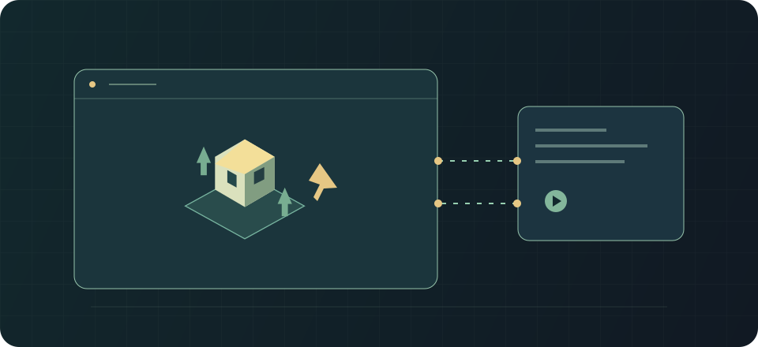

# Live: the active map

Applies to: Rimlink 0.8.1 · RimWorld 1.7 · protocol 1.

The owner simulates the map; the guest sends orders and receives updates.

## Usage {#usage}

The guest proposes a live raid or visit with selected pawns. The host accepts the invitation (60 seconds by default). Once loaded, the guest sees a map mirror; commands execute on the host, who remains authoritative for simulation and saving.

The slower requested speed wins. The guest has a separate pause budget (10 pauses of 60 seconds by default). Letter-triggered pauses use the stricter participant preference. The guest can leave; the host can abort.

After losing connection, wait for PeerBack/reconnection. Retries continue every 60 seconds; after two minutes the game offers the menu. Desynchronization calls for a fresh snapshot, not manual map editing.

## Limits and safety {#limits}

The host must stay online. Live does not create an independent second save. Do not end a session by deleting journals or manually granting pawns.

## See also {#related}

- [Persistent shared colony](./coop.md)
- [Raids and paid incidents](./raids-incidents.md)
- [Player troubleshooting](./troubleshooting.md)
