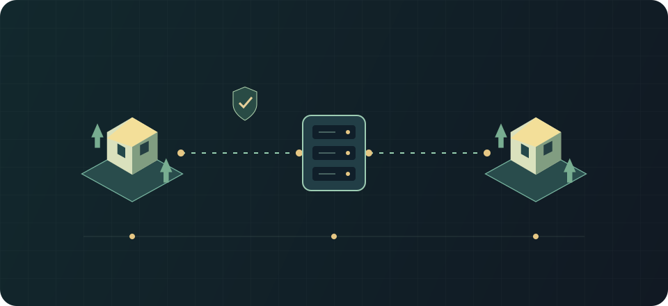

# Подключение и вход

Применимость: Rimlink 0.10.4 · RimWorld 1.7 · протокол 1.

Две колонии подключаются к серверу по защищённому соединению.

## Как пользоваться {#usage}

<ol class="flow-diagram" aria-label="Схема процесса"><li><strong>Адрес и TLS</strong>Сверь сервер и отпечаток.</li><li><strong>Личный вход</strong>Steam или разрешённый парольный аккаунт.</li><li><strong>Сборка</strong>Diff → разрешённая установка → restart → сверка.</li><li><strong>Колония</strong>Текущий серверный сейв либо новая колония.</li></ol>

В меню **Мультиплеер** добавь host и порт (по умолчанию 25560). Адрес выдаёт администратор; браузерный URL панели и игровой endpoint не обязательно одинаковы. Если сервер защищён общим паролем, он нужен дополнительно к личному входу.

Steam-вход использует билет Steam. Парольный вход доступен только когда сервер разрешил его; логин и пароль относятся к этому серверу. Новый сертификат запомнится после доверия. При изменении pin сначала спроси администратора, действительно ли сертификат заменён.

После входа сервер либо загружает сохранённую колонию, либо предлагает создать новую, либо показывает различия набора модов. Исправь указанные различия и подключись снова.

В текущих исходниках дополнительно проверяются моды из заголовка собственного сохранения. При неактивных модах вход останавливается со списком названий до загрузки карты и recovery-операций. Проверка применяется и до отправки локального recovery-сейва. Включи требуемые моды и повтори вход; не удаляй сейв или журнал восстановления. Это исправление ещё не выпущено в 0.9.2.

После отката колонии администратором вернись в главное меню и войди снова. Клиент скачает выбранное сервером сохранение, проверит исходное доказательство владения и запишет дальнейший прогресс в новой эпохе записи. Более новое локальное сохранение, ожидающее отправки, хранится отдельно.

## Вход по шагам: сертификат, учётная запись, колония {#login-flow}

1. Открой сохранённый сервер либо добавь точные host/port. URL браузерной панели может отличаться от игрового адреса.
2. При первом TLS-подключении сравни отпечаток с сообщением администратора по другому каналу. Сохраняй доверие только после сверки. Изменённый pin — отдельная остановка, не обычная кнопка «продолжить».
3. Введи общий пароль сервера, если он включён. Он не заменяет Steam-ticket или личный пароль.
4. Для Steam дождись результата проверки билета; временный отказ может автоматически повторяться. Для парольного входа используй учётную запись именно этого сервера. Администратор должен разрешить этот метод.
5. Пройди сверку сборки. Далее сервер либо загружает текущую колонию, либо предлагает новую. Если ожидаешь старую — прежде создания проверь аккаунт и адрес.

**Успех:** загружена домашняя карта, соединение активно, нет незавершённого восстановления. Имя в публичном списке и логин учётной записи — не взаимозаменяемые значения.

## Различай временное ожидание и окончательный отказ {#login-refusal}

«Waiting for Steam to accept the login» означает ожидание Steam, не повреждение сейва. «login details are invalid» требует проверки данных. «This account logged in from another place» останавливает эту копию: не продолжай её как независимую временную линию.

При обычном обрыве игра ставит паузу и переподключается: сначала через секунду, затем реже, максимум раз в минуту. Через две минуты можно выбрать ожидание или меню; попытки продолжаются за окном. Окончательный отказ (например, бан или неподтверждённый новый сертификат) требует возвращения в меню и устранения причины. Сохрани локальные данные, не заменяй их другой колонией.

## Ограничения и безопасность {#limits}

Не отключай TLS ради устранения ошибки сертификата. Не передавай личные пароли через чат. При временном отказе Steam дождись повторной проверки, не создавай много новых аккаунтов.

Для гильдейского захвата клиент отдельно согласует GuildVersion. Сохранённая история гильдейской доставки требует поддержки этого формата и после получения ресурсов. Пока захват на сервере не включён, обычный вход с такой историей отказан; совместимый администратор может проверить данные. Ответ входа пока не рекламирует готовность гильдейской функции.

## См. также {#related}

- [Набор модов сервера](./modpacks.md)
- [TLS, вход и права](../admins/security-auth.md)
- [Проблемы игрока](./troubleshooting.md)
