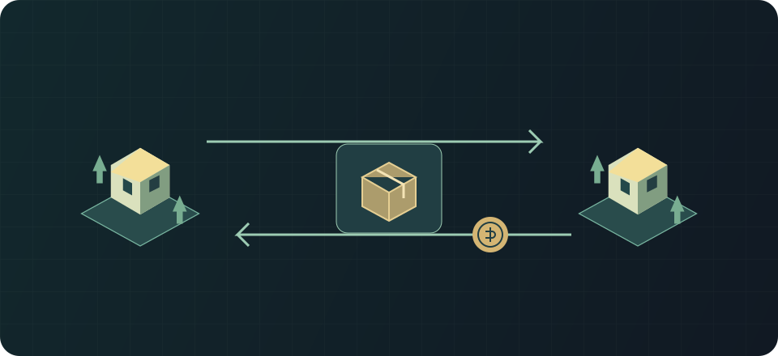

# Кошелёк, почта и рынок

Применимость: Rimlink 0.8.1 · RimWorld 1.7 · протокол 1.

Обмен проходит через серверный escrow; доставка — через почту.

## Как пользоваться {#usage}

Для штатных операций нужны консоль связи и запитанные торговые маяки; предметы выбираются из обслуживаемой зоны. Кошелёк — серверный баланс серебра, а не стопка на карте. Внесение серебра переносит его в баланс; вывод доставляется через серверную посылку.

Выставь предметы или пешку обычным лотом, задай цену и проверь состав. Покупатель платит кошельком, товар уходит в доставку, продавец получает выручку с учётом комиссии. Непроданные лоты по умолчанию истекают через 30 дней.

Проверяй почту после сделки и обрыва соединения. Сервер удерживает отправленное в эскроу до завершения, а возвраты оформляет посылками.

## Ограничения и безопасность {#limits}

По умолчанию хранение после 3 бесплатных дней стоит 0,5% в сутки. Долг, угроза на карте, заморозка или запрещённые defName ограничивают операции. Комиссии и лимиты задаёт сервер.

## См. также {#related}

- [Подарки и двусторонние сделки](./gifts-trades.md)
- [Аукционы](./auctions.md)
- [Заказы, контракты и общие цели](./procurement.md)
