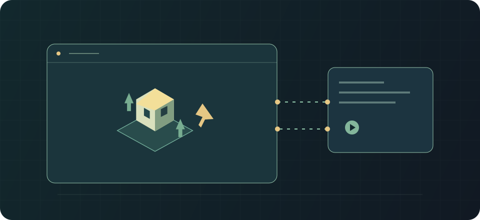

# Live: живая карта

Применимость: Rimlink 0.10.0 · RimWorld 1.7 · протокол 1.

Владелец симулирует карту; гость передаёт приказы и получает обновления.

## Как пользоваться {#usage}

Гость предлагает live-рейд или live-визит с выбранными пешками. Хозяин принимает приглашение (по умолчанию 60 секунд на ответ). После загрузки гость видит зеркало карты; команды исполняются у хозяина, который остаётся авторитетом симуляции и сейва.

Скорость согласуется по более медленному запросу. Гость использует собственный бюджет пауз (по умолчанию 10 по 60 секунд). Пауза на письмах учитывает более строгую настройку участников. Для окончания гость выходит, хозяин может прервать сессию.

При потере связи дождись PeerBack/переподключения. Повторы продолжаются каждые 60 секунд; после двух минут предлагается выход в меню. Рассинхронизация требует нового снимка, а не ручной правки карты.

## Совместная сессия: действия гостя и хозяина {#live-flow}

1. Гость отправляет live-рейд/визит караваном или капсулами. Хозяин должен быть онлайн дома.
2. Хозяин отвечает на приглашение за минуту. При отказе/таймауте рейд продолжится обычным выбранным режимом; пешки live-визита вернутся почтой.
3. Игра гостя сохраняет дом и загружает зеркало. Хозяин ждёт готовности зеркала с паузой.
4. Гость выделяет **свои** пешки, отдаёт приказы, меняет работу/расписание. Всё исполняется у хозяина; остальные объекты доступны для просмотра.
5. В верхнем правом оверлее следите за состоянием, tick и паузами. Действует меньшая из выбранных скоростей; H/G показывают пожелания сторон.
6. Гость выбирает «End session», хозяин — «Abort session». Вернувшиеся пешки и допустимая добыча приходят по серверному результату, не путём копирования зеркального сейва.

Работник аванпоста на карте хозяина во время визита остаётся зеркалом пешки гостя. Защищённый возврат использует исходный UUID работника и серверную квитанцию.

Домашнее сохранение перед загрузкой зеркала содержит реестр UUID и защитные квитанции, даже когда live-сессия уже началась. Если этот реестр неоднозначен, загрузка зеркала останавливается до записи домашнего сохранения.

Когда все гостевые пешки мертвы, пленены или ушли, хозяин завершает сессию. Живая, но лежащая/переносимая пешка всё ещё может удерживать её активной.

## Паузы, отставание зеркала и разрыв {#live-failure}

Бюджет гостя по умолчанию — десять пауз до минуты. Хозяин не расходует этот бюджет. Пауза по письму берёт более строгое из настроек сторон (Never / Major / Any threat), не расходует гостевой лимит и снимается выбором скорости. Это заменяет ванильную авто-паузу на время сессии.

Если зеркало отстало, запрашивается новый снимок; не пытайся «свести» карты ручным редактированием. При потере стороны другой участник ждёт несколько минут. После истечения ожидания потерянный рейдер передаётся AI хозяина; при потере хозяина завершение будет сообщено его игрой после следующего входа. Это может отложить возврат, поэтому не создавай пешек вручную.

Coop использует похожее зеркало, но назначенные пешки принадлежат хозяину и никогда не являются гостевой почтовой поставкой.

## Ограничения и безопасность {#limits}

Хозяин должен оставаться онлайн. Live не создаёт самостоятельную вторую версию сейва. Не завершай сессию удалением журналов или принудительной выдачей пешек.

В разрабатываемом Product клиент откладывает фоновое восстановление, пока гильдейская доставка владеет точным сохранением и журналом. Выдача разрешена только дома. Полный отдельный контекст карты гильдейского боя ещё не реализован и не объявляется проверенным live-сценарием.

## См. также {#related}

- [Постоянная совместная колония](./coop.md)
- [Рейды и платные события](./raids-incidents.md)
- [Проблемы игрока](./troubleshooting.md)
